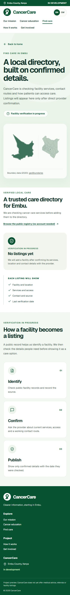

# Dedicated Find care page

The Find care branch now opens at `/find-care/` from the header, homepage focus card, Embu pilot, Learn guide, and footer. The homepage keeps a short route into the page instead of repeating the full directory section.

The page shows the Embu map and a clear empty state. No facility is presented as a current cancer care option yet. It links to the public National Health Facility Registry for independent browsing, while explaining that a registry entry alone does not confirm current cancer services or patient access.

The three visible steps are: identify a facility from a recorded source, confirm its current services and access route directly with the provider, then publish checked details with a verification date. This is available in English and Kiswahili. The existing facility data checks remain the gate for adding listings.

## Verification

- `pnpm build` creates `dist/find-care/index.html` alongside the home and Learn pages.
- `pnpm test:facilities` passes all five facility checks.
- Browser review confirmed the map loads, the empty state and process are visible, the Learn link opens `/learn/`, the language switch works, and the mobile page has no horizontal overflow at a 390 px viewport.

The next content step is direct provider confirmation of the first Embu facility. Until then, the directory correctly remains empty.
