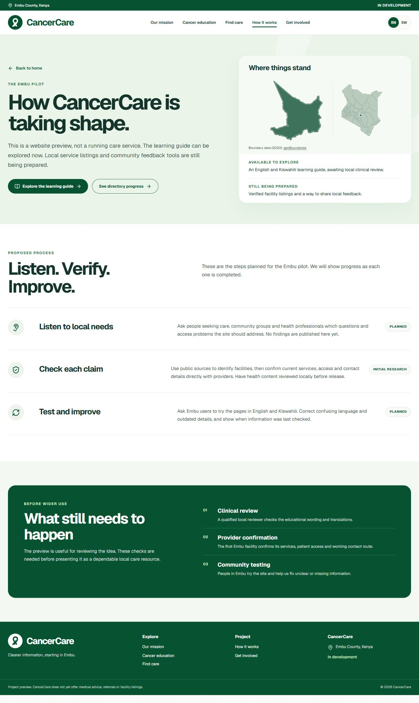

# Dedicated How it works page

The header's How it works branch now opens `/how-it-works/`. The homepage hero, Embu pilot section, focus card and footer also link to it. Vite builds a separate static HTML entry for direct visits.

The page distinguishes the current website preview from the proposed Embu pilot. Visitors can explore the bilingual Learn guide, which still needs local clinical review. The facility directory has no published listings, and there is no live feedback or referral service. Preliminary facility research has started, but direct provider confirmation has not been completed.

The proposed work is shown as three steps: listen to local needs, check claims and services, then test and improve with Embu users. The page names clinical review, provider confirmation and community testing as work needed before presenting the site as a dependable local resource. It makes no claim that community interviews, provider agreements or user testing have happened.

## Verification

- `pnpm build` creates `dist/how-it-works/index.html` alongside the other pages.
- `pnpm test:facilities` passes all five facility checks.
- Browser review confirmed desktop and phone layouts, loaded Embu map, English/Kiswahili switching, homepage navigation, and no horizontal overflow at 390 px.

