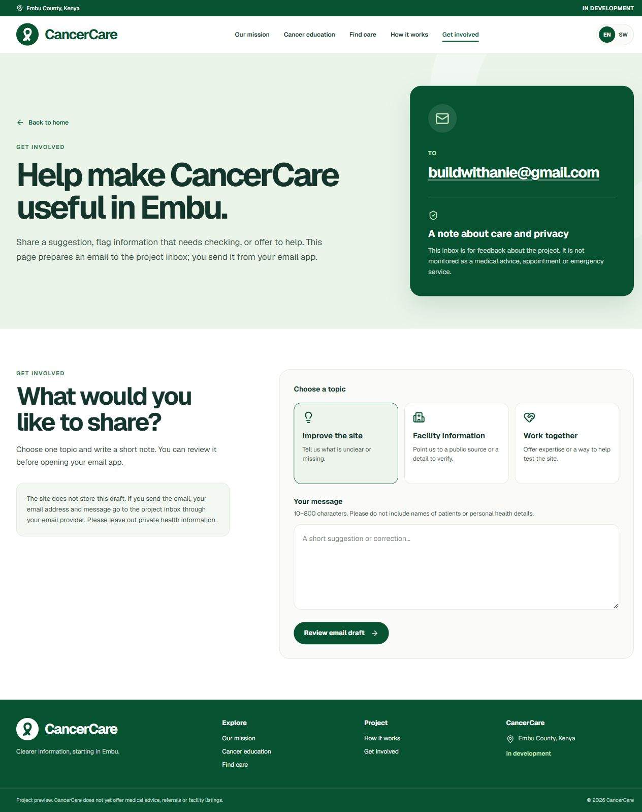

# Get involved email flow

The Get involved branch now opens `/get-involved/` from the header, homepage focus card, community section and footer. The page is available in English and Kiswahili.

Visitors can choose site improvement, facility information or collaboration, write a short message, and review a prefilled email to `buildwithanie@gmail.com`. The draft opens through a `mailto:` link. A copy button and the visible recipient address provide a fallback when no email app is configured. The page never claims that reviewing or opening the draft has sent it; the visitor must press Send in their own email app.

The page asks visitors not to include patient names or private health information. It says the inbox is for project feedback, not medical advice, appointments or emergencies. The draft remains in browser memory only; CancerCare does not store or transmit it automatically. Sending email shares the sender address and message through the visitor's email provider.

## Verification

- `pnpm build` creates `dist/get-involved/index.html` alongside the other pages.
- `pnpm test:facilities` passes all five facility checks.
- Browser review checked empty-message validation, topic selection, encoded email subject and body, copy fallback, language switching, mobile layout and no horizontal overflow at 390 px. Switching languages clears a prepared draft so its subject and labels cannot remain in the previous language.
- No email was sent during testing.

This is an email handoff, not an in-site submission service. A future direct-submit form would need a configured mail or storage service, monitoring, and a reviewed privacy process before it could truthfully show delivery confirmation.
