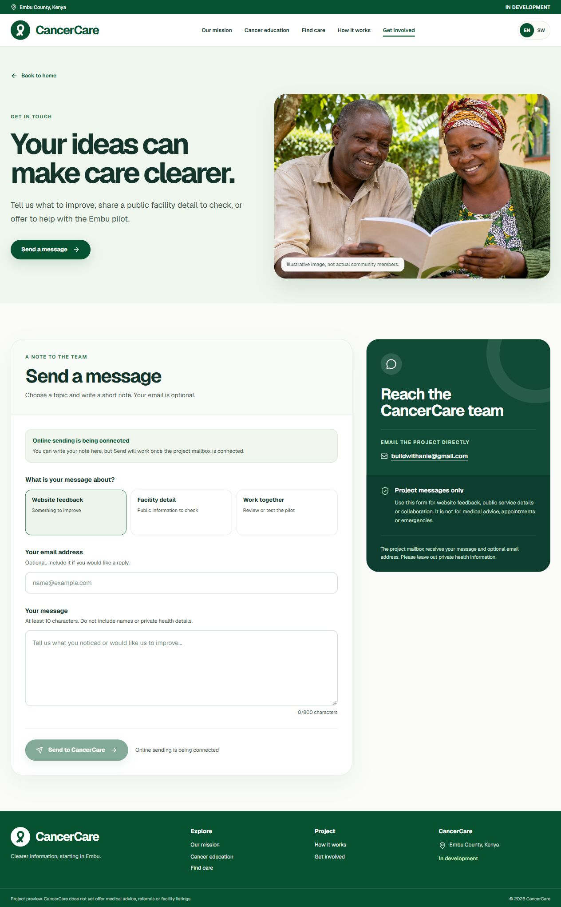

# Contact page and Nodemailer delivery

The `/get-involved/` form lets visitors choose a feedback topic, add an optional reply address, and write a message in English or Kiswahili. It asks them not to include patient names or private health details. This is for project feedback, not medical advice, appointments or emergencies.

The Cloudflare Pages Function at `/api/contact` validates the submission and uses [Nodemailer](https://nodemailer.com/smtp) to send through Gmail SMTP on port 465 with TLS. The sender and recipient are `buildwithanie@gmail.com`; a visitor's address is used only as `Reply-To`. The API reports success only if Gmail accepts the recipient. A successful SMTP response does not prove the message reached the inbox. The site does not store messages in a database.

The redesigned page has a community image, a prominent form, and a separate panel for the project email and safety information. The form stays visible even before SMTP is configured. Send is disabled until the mailbox connection is ready; a direct email address remains visible. On narrow screens, the form appears before the additional project notes.

## Enable on Cloudflare Pages

1. The owner of `buildwithanie@gmail.com` must enable two-step verification and create a [Google app password](https://support.google.com/mail/answer/185833?hl=en) for the site. Use the app password, never the normal Gmail password. Google may not offer app passwords for every account configuration.
2. For local testing, put `SMTP_PASS=your-app-password` in the ignored `.env` file. The committed `.env.example` shows the required variable name. `pnpm dev` and `pnpm preview` expose `/api/contact` through a local adapter to the same handler used by Cloudflare Pages. Wrangler Pages development also reads `.env` and can be used to check the Cloudflare runtime.
3. In the Cloudflare Pages project, add the same `SMTP_PASS` value under **Settings → Variables and Secrets → Add**, select **Encrypt**, then save it for production. A local `.env` file is not deployed, and it must never be committed or copied into `dist/`. Add the secret to preview environments only if testing there is intended.
4. Set the Pages Functions compatibility date to `2026-08-04` or later, or enable `nodejs_compat` if the project uses an earlier date. Cloudflare's [Node compatibility documentation](https://developers.cloudflare.com/workers/runtime-apis/nodejs/net/) covers the networking support that Nodemailer needs. If the project already has a Wrangler configuration, preserve its settings instead of replacing it with a generic file.
5. Deploy the frontend and Function together. Confirm `/api/contact` returns `{ "ready": true }` on the deployed site. Send a non-sensitive test message, then confirm it arrives in the Gmail inbox and is visible in Sent mail.
6. Add Cloudflare rate limiting or Turnstile before broad public use. The current origin check and honeypot do not stop all automated submissions. SMTP retries after uncertain network failures may produce duplicate messages; there is no durable idempotency store yet.

Cloudflare blocks outbound SMTP on port 25; this implementation uses encrypted port 465. See [Cloudflare's TCP socket limits](https://developers.cloudflare.com/workers/runtime-apis/tcp-sockets/).

Until `SMTP_PASS` exists, `/api/contact` returns `{ "ready": false }`; the page remains fillable and disables Send. The Vite server uses a local adapter for development. A deployed Pages environment needs its own encrypted secret for live sending.

## Checks

- `pnpm build`
- `pnpm test:contact`

The automated tests check SMTP configuration, validation, cross-origin requests, recipient acceptance, and SMTP failures using a mock transporter. Wrangler compiled the Pages Function with Node compatibility; its local runtime returned `ready: false` and HTTP 503 for submission without the secret. Browser checks confirmed the redesigned desktop and mobile layouts and English/Kiswahili labels.

On 11 November 2026, a non-sensitive test submission through the contact handler returned HTTP 202 with Gmail accepting `buildwithanie@gmail.com`. The mailbox owner confirmed the message arrived. A second submission through the local Cloudflare Pages runtime also returned HTTP 202. The configured Desktop project now serves `/api/contact` through Vite as well; `http://localhost:5173/api/contact` returned `{ "ready": true }`, and the Send button was confirmed enabled in the browser. The deployed Cloudflare Pages Function still needs its own encrypted `SMTP_PASS` secret and a separate live test.
