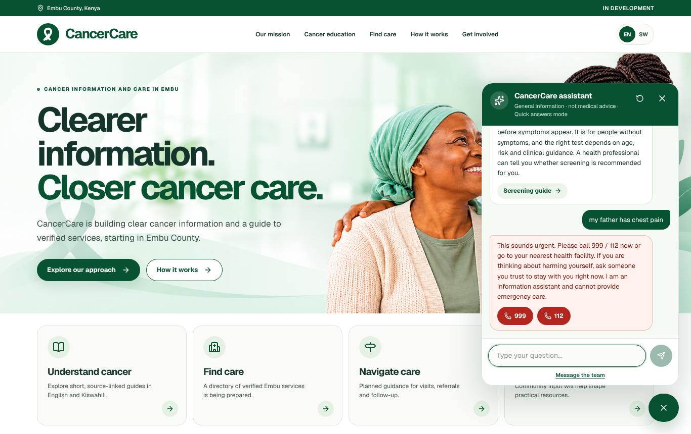
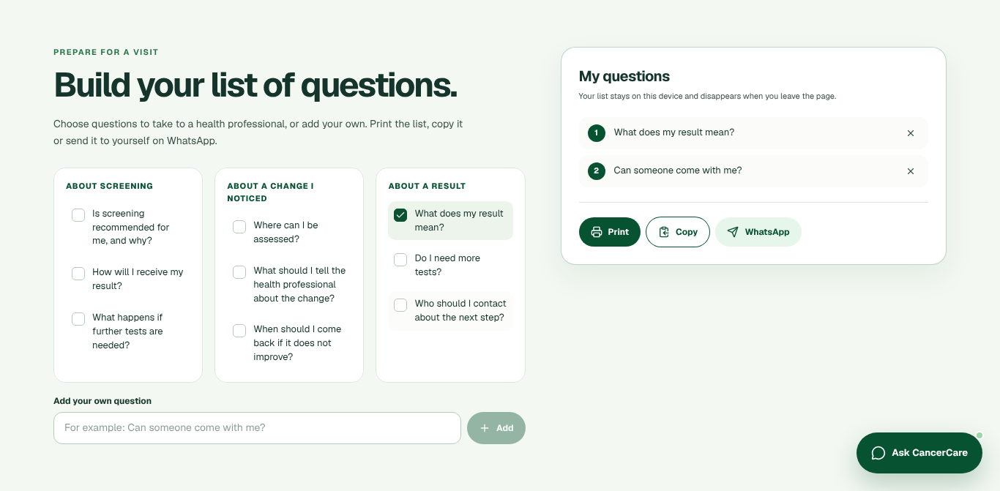
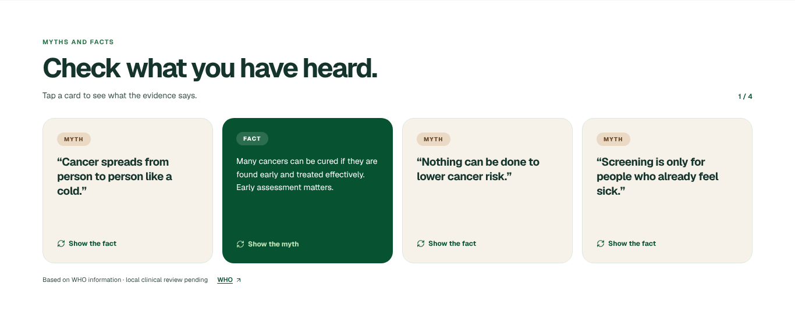

# CancerCare assistant and interactive learning

This step adds a bilingual chat assistant to every page, two interactive learning tools, and basic site completeness fixes.

## CancerCare assistant (chatbot)

A floating **Ask CancerCare** button opens a chat panel on every page. It answers general questions about cancer, screening, results, prevention, finding care in Embu and getting involved, in English or Kiswahili (it follows the site language switch).

It works in two modes:

| Mode | When | How answers are made |
| --- | --- | --- |
| AI answers | `ANTHROPIC_API_KEY` is set | `/api/chat` (Cloudflare Pages Function) sends the conversation to the Anthropic Messages API with a strict safety prompt built from `shared/assistant.js`. |
| Quick answers | No key, or the AI call fails | The browser matches the question to reviewed site answers in `shared/assistant.js` and links to the right page. |

The quick-answers mode means the chat is useful even before an API key is configured. The header shows "Quick answers mode" when it is active.

### Safety rules

- General education only. The prompt forbids diagnosis, interpreting someone's symptoms or results, treatment or dose advice, and risk estimates.
- Messages that sound like a medical emergency or self-harm skip the AI and always get a fixed reply with **999** and **112** call buttons. This runs both in the browser and on the server.
- The assistant must not name or invent facilities, phone numbers, prices or hours. The directory has no confirmed listings, so it points to `/find-care/`.
- Visitors are asked not to share names or private health details. Nothing is stored on the server. The conversation is kept only in the visitor's browser tab (`sessionStorage`) so it survives moving between pages, and **Start over** clears it.
- `/api/chat` checks the origin, caps each message at 600 characters and a conversation at 12 messages, and applies a best-effort limit of 12 requests per minute per address. Add Cloudflare rate limiting or Turnstile before broad public use, because the in-memory limit is per isolate.

To change what the assistant knows, edit the topics in `shared/assistant.js` (both languages). The same file builds the AI system prompt.

### Enable AI answers

1. Create an API key in the Anthropic Console.
2. Local: add `ANTHROPIC_API_KEY=...` to the ignored `.env` file (see `.env.example`) and run `pnpm dev`. `http://localhost:5173/api/chat` should return `{ "ready": true }`.
3. Cloudflare Pages: add `ANTHROPIC_API_KEY` under **Settings → Variables and Secrets** as an **encrypted** secret for production. Optionally set `CHAT_MODEL` to override the default model (`claude-haiku-5-5`).
4. Deploy, confirm `/api/chat` returns `{ "ready": true }`, and ask a few test questions in both languages. Set a monthly spend limit in the Anthropic Console.

## Questions for a health visit (`/learn/#visit-questions`)

Visitors tick questions from three groups (screening, a change they noticed, a result), add their own, and then print, copy or share the list to themselves on WhatsApp. Printing prints only the list. The list is never saved.

## Myths and facts (home and `/learn/#myths`)

Four flip cards contrast common myths with facts based on the WHO cancer fact sheet. A counter shows how many have been revealed. The wording awaits local clinical review, like the rest of the education content.

## Site completeness

- Sections fade in on scroll (turned off for people who prefer reduced motion).
- Footer share buttons: WhatsApp and copy link.
- `404.html` page in both languages; Cloudflare Pages serves it for unknown paths.
- Favicon based on the CancerCare mark, Open Graph tags on every page, and `robots.txt`.
- Shared page routing in `src/lib/pages.ts`.
- The Learn page's third step now jumps to the question builder.

## Checks

- `pnpm build`
- `pnpm test` (contact, facilities and chat tests). The chat tests cover readiness, the missing-key fallback, emergency replies, the safety prompt, request validation, AI failures and rate limiting, using a mock API.
- Browser checks at 1366 px and 390 px in English and Kiswahili: chat, emergency reply, question builder, flip cards and the 404 page, with no console errors.

Not yet tested: a live AI conversation, because no API key was available while building. Do this after step 2 or 3 above.
