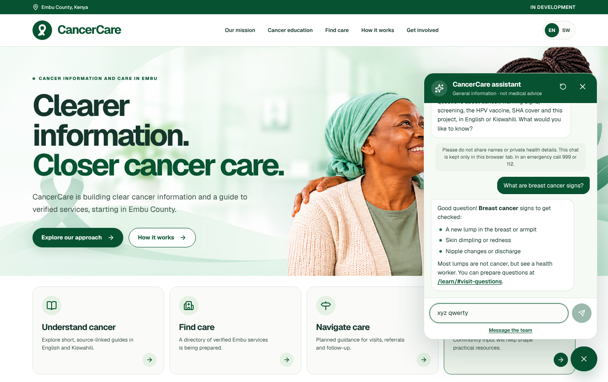
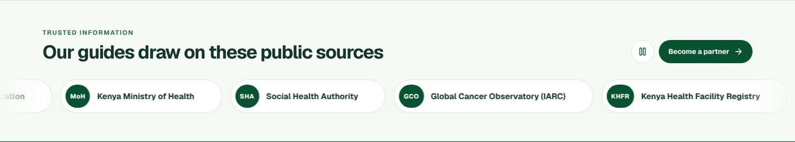
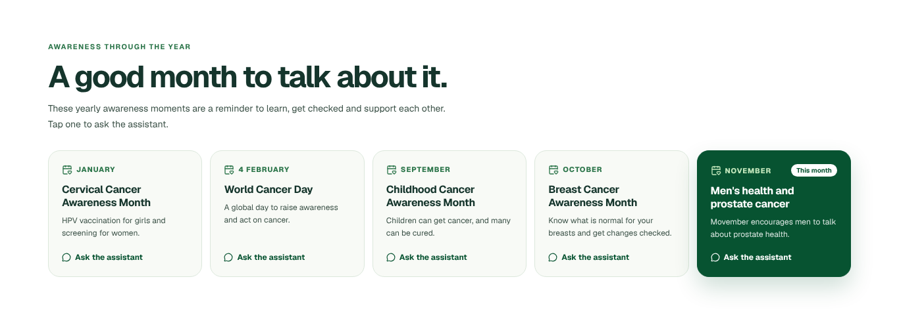

# Smarter assistant, partners strip and awareness calendar

## A smarter CancerCare assistant

**AI mode (Gemini).** This is what makes the assistant genuinely conversational, so it can answer almost any cancer question and follow up. It needs `GEMINI_API_KEY` (see step 21).
- The prompt now asks Gemini to answer any cancer-related question well: types, causes, prevention, signs, tests, staging, treatment and side effects, nutrition, pain, palliative care, caregiving, survivorship and myths. It should give real, specific information instead of only "see a doctor".
- The safety limits stay. It must not diagnose or say whether someone's own symptom or result is cancer. It must not pick treatments or doses, estimate personal prognosis, invent facilities, or claim herbal cures.
- `maxOutputTokens` was raised to 2048. Newer Gemini models spend part of that budget on internal reasoning, and the old 400-token limit could cut replies short or leave them empty.
- Replies render short lists, **bold** text and links to site pages.

**Quick answers mode (no key)** is still keyword based, but much broader:
- 16 new bilingual topics in `shared/cancer-topics.js`:
  - breast, cervical, prostate, oesophageal, colorectal, childhood and liver cancer
  - causes and risk factors, family history, healthy lifestyle
  - treatment side effects, tests and biopsy, stages
  - "is cancer contagious?", cancer pain, life after treatment
- Specific cancer topics win over broad ones, so "I found a lump in my breast" gets the breast cancer answer.
- It tolerates one typo in longer words ("prostrate", "screning"), but only when no exact match exists. This keeps "habari" from being read as "hatari".
- When it has no answer, it now offers suggested questions instead of a dead end.

Any page can open the assistant with a question by calling `askAssistant('...')` from `src/components/ChatWidget.tsx`.

## Partners / trusted sources strip

A scrolling strip on the home and How it works pages, edited in `src/data/partners.ts`.

- `kind: 'source'` lists public bodies whose information the guides use: WHO, the Ministry of Health, SHA, the IARC Global Cancer Observatory, the Kenya Health Facility Registry, WHO Africa and geoBoundaries. While there are only sources, the strip is titled **"Our guides draw on these public sources"**. It does not claim these bodies are partners.
- `kind: 'partner'`: add an organisation once it has **agreed in writing** to partner. As soon as there is at least one, the strip switches to **"Our partners"** and shows only partners.
- Items show a lettered badge. Add `logo: '/file.png'` only with the organisation's permission to use its logo.
- The strip pauses on hover, on keyboard focus and with the pause button. It becomes a still, wrapped list for people who prefer reduced motion. A **Become a partner** button links to the contact page.

## Awareness through the year

A home page section with five yearly awareness moments:
- Cervical Cancer Awareness Month (January)
- World Cancer Day (4 February)
- Childhood Cancer Awareness Month (September)
- Breast Cancer Awareness Month (October)
- Men's health and prostate cancer (November)

The current month is highlighted, and tapping a card opens the assistant with a related question.

## Checks

- `pnpm build`
- `pnpm test` (23 tests)
- Browser checks at 1366 px and 390 px: marquee, awareness cards opening the chat, quick answers, and a simulated AI reply with list formatting. No console errors.
