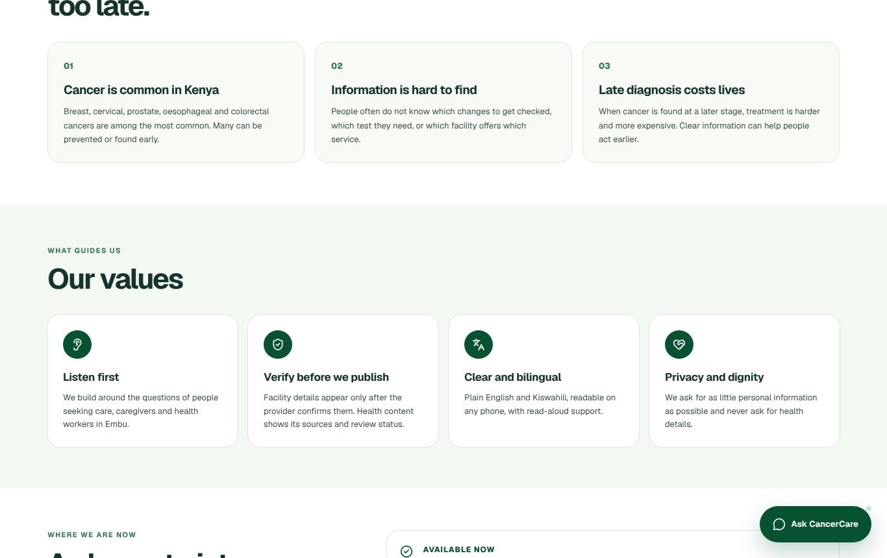
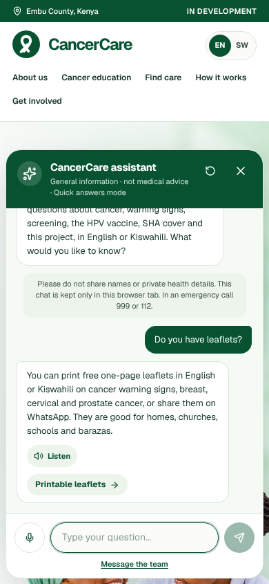
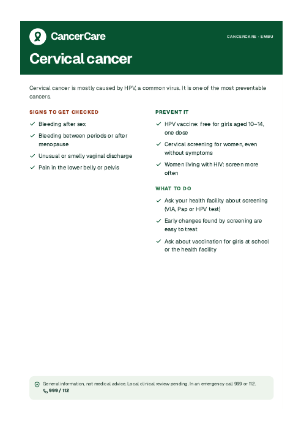

# About page, privacy and terms, voice features and printable leaflets

## About us (`/about/`)

The About page covers why CancerCare exists, its values, and an honest "where we are now" summary (available, in progress, not offered). It ends with a call to join or email the team. "About us" replaces "Our mission" in the top navigation; the mission section stays on the home page.

Facts about the organisation live in `src/data/organisation.ts`, and **empty fields are hidden**:
- `registration`: add the NGO registration line in English and Kiswahili once registered.
- `founded`: the year the project started.
- `team`: name and role in both languages, plus an optional photo, used only with the person's permission. The team section appears only when at least one person is listed.

## Privacy & terms (`/privacy/`)

A plain-language privacy notice and terms of use, in both languages, with a contents list. The privacy notice describes how the site actually works:
- **Contact form:** goes to the project Gmail inbox; nothing is stored in a database.
- **Assistant:** sent to the Gemini API only when AI is switched on; in quick answers mode nothing leaves the device.
- **Browser storage:** only the language choice and the current chat, for the open tab.
- **Hosting:** Cloudflare processes technical data such as IP addresses.
- **Voice:** read-aloud uses device voices; the microphone uses the browser's speech service.
- **Rights:** visitors' rights under Kenya's Data Protection Act, 2019.

The terms cover: general information only, emergencies (999/112), that the assistant can make mistakes, facility information, review status, and fair use.

Links to it appear in the footer and next to the contact form.

**Before wide launch:** have the notice reviewed by someone familiar with Kenyan data protection law. Update the date and the text whenever data handling changes, for example if analytics or a database is added. The notice promises to delete contact messages on request and to keep them only as long as needed, so the mailbox owner must honour that.

## Read aloud and voice questions

- **Listen** buttons appear on assistant replies, Learn page answers and each leaflet. They use the device's built-in voices (Web Speech API), at no cost and with no network. The button is hidden when the device has no voice for the current language. Kiswahili voices are common on Android but not on every computer.
- A **microphone** button in the chat lets visitors speak their question (English `en-KE` or Kiswahili `sw-KE`). The text fills the box so they can check it before sending. It appears only in browsers that support speech recognition, such as Chrome, Edge and Samsung Internet. In Chrome the browser sends the audio to Google to convert it to text, and the privacy notice says so.

## Printable leaflets (`/resources/`)

Four one-page leaflets: Know the signs, Breast cancer, Cervical cancer and Prostate cancer. Each has signs to get checked, prevention, what to do, and the 999/112 emergency line. Each leaflet has buttons to:
- **Print or save as PDF:** prints only that leaflet on a single A4 page with larger text.
- **Share on WhatsApp:** shares a link straight to that leaflet.
- **Listen:** reads the leaflet aloud.

Switch the site language to print the Kiswahili version. The leaflet text is in `src/content-pages.ts`.

Printing uses `printOnly()` in `src/lib/print.ts`, which the visit question list now uses too. It hides everything except the chosen element, so no blank pages follow.

## The assistant knows about these pages

New quick-answer topics cover leaflets and privacy, and the AI prompt lists `/about/`, `/resources/` and `/privacy/`.

## Checks

- `pnpm build`
- `pnpm test` (24 tests)
- Browser checks at 1366 px and 390 px for About, Privacy, Leaflets and the chat with the microphone. A4 print-to-PDF of a leaflet and the visit list each produced one page. No console errors.
