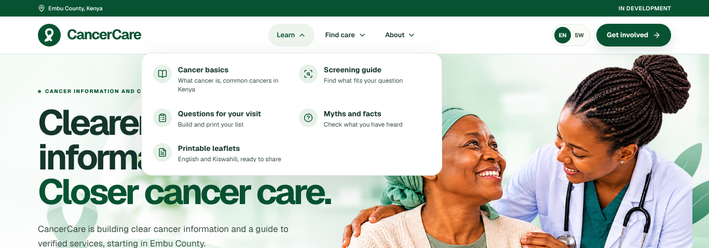
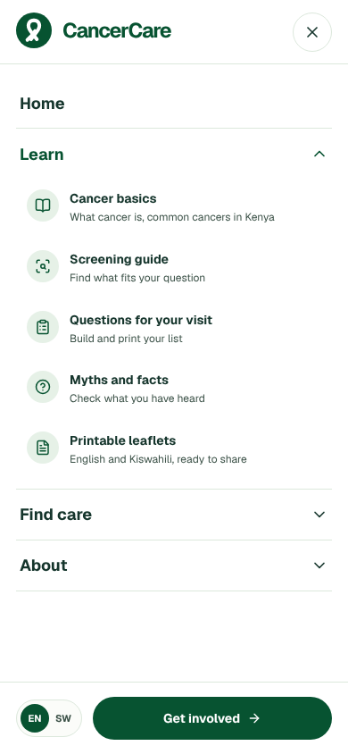

# Grouped navigation menus

The main menu now has three dropdown groups and a highlighted **Get involved** button. The footer uses the same groups. Both are built from one list in `src/data/navigation.ts`, so adding a link there updates the menu and the footer together.

| Learn | Find care | About |
| --- | --- | --- |
| Cancer basics (`/learn/#learn`) | Care directory (`/find-care/`) | About us (`/about/`) |
| Screening guide (`/learn/#screening`) | How listings are checked (`/find-care/#verification`) | How it works (`/how-it-works/`) |
| Questions for your visit (`/learn/#visit-questions`) | Paying for care (`/learn/#paying-for-care`) | Partners and sources (`/about/#partners`) |
| Myths and facts (`/learn/#myths`) | | Privacy and terms (`/privacy/`) |
| Printable leaflets (`/resources/`) | | |

Each link has an icon and a one-line description in English and Kiswahili.

## Desktop

Hovering over or clicking a group opens its panel. The panel closes when the pointer leaves, when you click elsewhere, or when you press **Esc**, which returns focus to the menu button. Tab, Enter and Space work throughout. The group containing the current page is underlined.

## Phone and tablet

A ☰ button opens a full-screen menu:
- **Home**, then the three groups as fold-out sections. The current page's group starts open.
- The language switch and a large **Get involved** button sit at the bottom.

Page scrolling is locked while the menu is open, and Esc or ✕ closes it. The language switch also stays in the header. This replaces the old two-row wrapped links.

## Deep links

- New anchors: `#verification` on Find care, `#partners` on the partners strip, and `#paying-for-care` and `#common-cancers` on Learn answers. Linking to a Learn answer opens it.
- Pages now scroll to the `#section` in the address after they render. Before, links such as `/about/#partners` from another page landed at the top.

## Checks

- `pnpm build`
- `pnpm test` (24 tests)
- Browser checks:
  - hover open and close, keyboard open, Esc closing with focus returned
  - deep links to each new anchor
  - phone menu open, fold-outs, navigation and auto-close
  - no console errors
