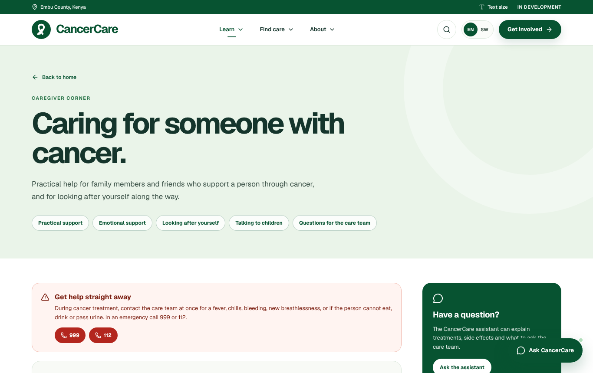
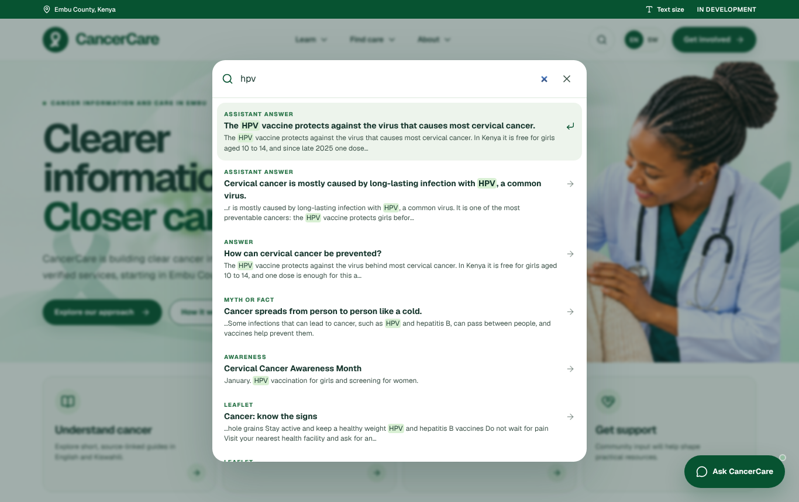
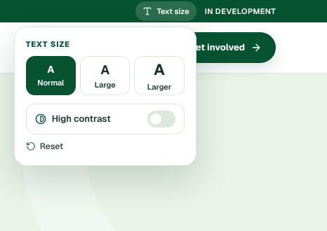
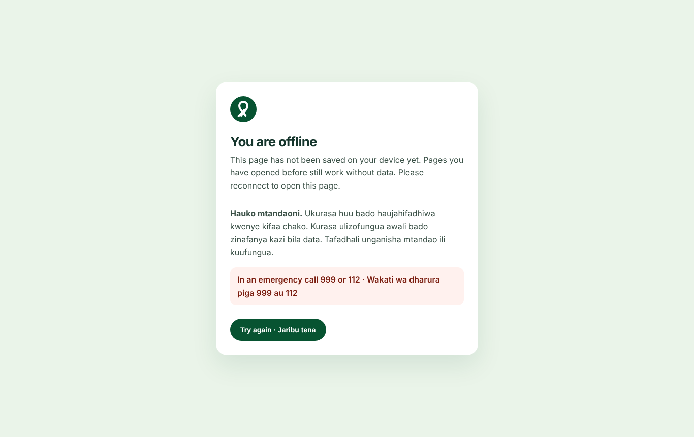

# Site search, reading options, offline app and caregiver corner

## Caregiver corner (`/caregivers/`)

A new page in the **Learn** menu for family and friends supporting someone with cancer.

It has five sections, each with a **Listen** button:
- practical support
- emotional support
- looking after yourself
- talking to children
- questions for the care team

The page also has:
- a red **Get help straight away** box: fever, chills, bleeding, breathlessness, or being unable to eat, drink or pass urine during treatment, plus 999/112 call buttons
- an **Ask the assistant** card
- a **Print this page** button

The text is in `src/content-caregivers.ts`. The assistant's support answer now links here. Local clinical review is pending.

## Site search

A 🔍 button in the header opens search. On a computer, pressing **/** also opens it. Search covers, in the current language:
- menu pages
- Learn answers
- the screening guide
- myths and facts
- visit questions
- awareness months
- leaflets
- caregiver sections
- privacy and terms
- all of the assistant's answers

Matching words are highlighted, and results can be chosen with the arrow keys and Enter. Choosing an assistant answer, or the last row, **Ask the assistant: "…"**, opens the chat with the search words. The index is built in the browser from the site text (`src/lib/search-index.ts`), so it needs no server and works offline.

## Reading options

An **Aa Text size** button sits in the green top bar on every screen size.
- **Text size:** Normal, Large (115%) or Larger (130%). This enlarges the page content, footer and chat; the header stays the same size so the menu still fits on phones.
- **High contrast:** darker text and borders, white backgrounds, underlined links and a strong focus outline.
- The choices are saved on the device (`cancercare.reading`) and applied before the page draws, so there is no flash.

## Works offline and installs like an app

- `public/sw.js` is a service worker, registered on the built site only.
  - Pages are network first, so visitors get fresh content, with the saved copy used when offline.
  - Built files, images and fonts are saved once.
  - `/api/` requests are never cached.
- The main pages are saved on the first visit, and the page sends the service worker the files it loaded, so the site works offline after one visit.
- An unsaved page shows a bilingual **You are offline** card (`public/offline.html`) with 999/112.
- A web app manifest and icons (192, 512, maskable, Apple touch) let phones add CancerCare to the home screen, with shortcuts to Learn, Leaflets and Caregiver corner. An **Install app** button appears in the footer when the browser offers installation, mostly Chrome on Android.
- When you change `sw.js` in a way that should replace saved files, change `VERSION` at the top of the file.

## Privacy notice

Updated to mention the saved reading options and the offline page copies, which contain no personal information.

## Checks

- `pnpm build`
- `pnpm test` (24 tests)
- Browser checks:
  - search in English and Kiswahili, with keyboard navigation
  - the caregiver page
  - reading options: high contrast, and Larger text on a 390 px phone with no sideways scrolling and the menu visible
  - offline mode: a visited page and the leaflets opened without internet, and an unvisited page showed the offline card
- No console errors apart from the expected offline network failure.
