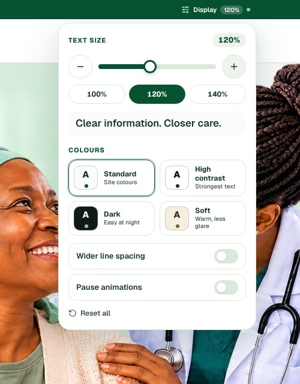
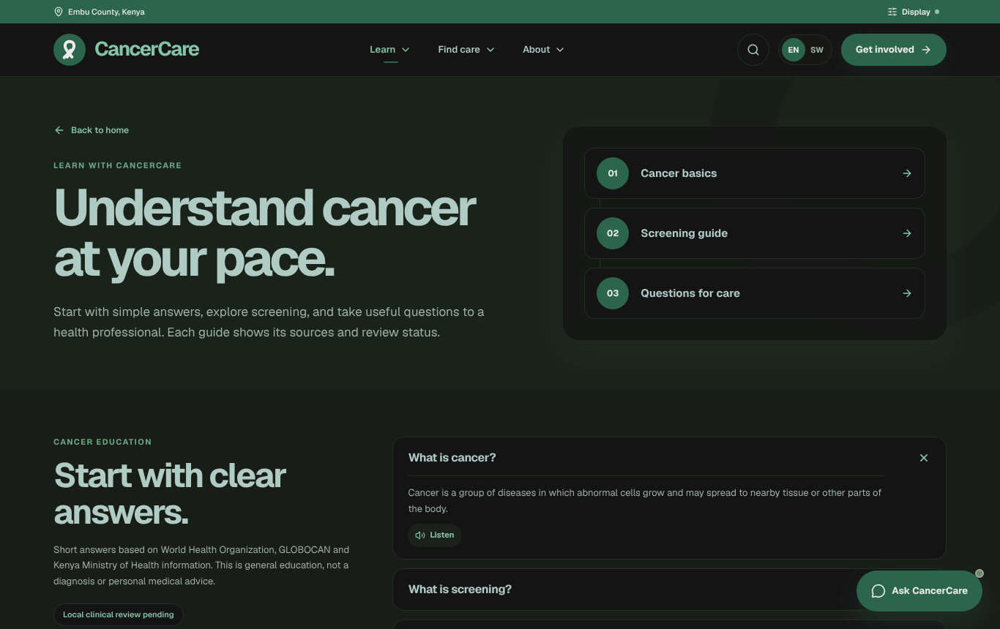
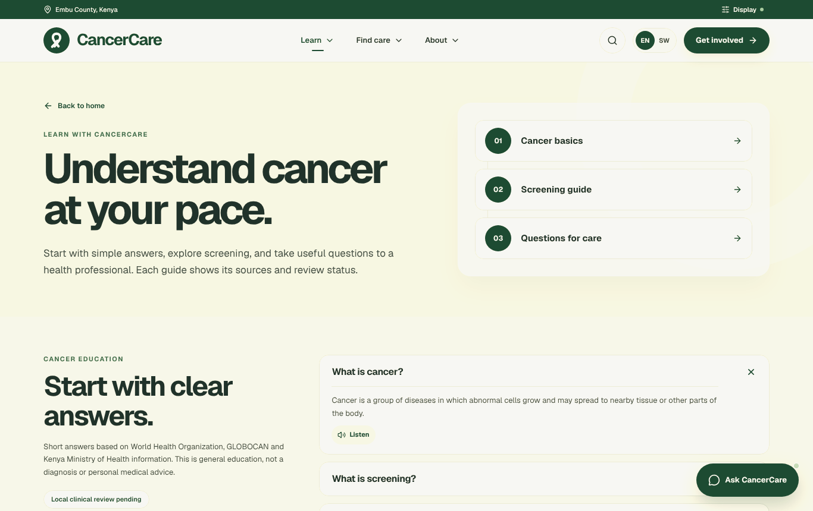

# Display options

The **Display** button in the green top bar, formerly "Text size", opens a panel of reading and colour choices. When a choice differs from the default, the button shows the current text size and a green dot. "In development" was removed from the top bar and footer, and the home page "Find care" card now says **Coming soon**.

| Option | What it does |
| --- | --- |
| **Text size** | Slider from 90% to 160% in 10% steps, − and + buttons, and quick choices of 100%, 120% and 140%. A preview line shows the size, and the current percentage is announced to screen readers. Page content, footer and chat are enlarged; the header stays the same size so the menu fits on phones. |
| **Colours** | **Standard** uses the site colours. **High contrast** gives darker text and borders, white backgrounds, underlined links and a strong focus outline. **Dark** suits night reading: photos keep their natural colours and the green blocks stay deep green. **Soft** uses warm paper tones with less glare. |
| **Wider line spacing** | More space between lines, letters and words in body text, which helps people who find dense text tiring. |
| **Pause animations** | Stops fade-ins, the moving partners strip and other motion. It is also applied automatically when the phone or computer asks for reduced motion. |
| **Reset all** | Returns to the defaults. |

Choices are saved on the device in `cancercare.reading` and applied before the page draws. Settings saved by the earlier version (three sizes plus contrast) are converted automatically.

The code is in `src/lib/reading.ts` (saving and applying) and `src/components/ReadingControls.tsx` (the panel), with styles under "Display options" in `src/index.css`.

## Checks

- `pnpm build`
- `pnpm test` (24 tests)
- Browser checks:
  - every colour mode
  - 140% on a 390 px phone with no sideways scrolling
  - the chat button stays in place in dark mode
  - pause animations stops the partners strip
  - older saved settings are converted
  - no console errors
