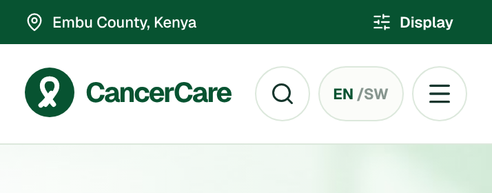

# Narrow-phone header and Vercel support

## Header on narrow phones

On phones narrower than about 400 px, the ☰ menu button was pushed off the right edge. Below 400 px the header now uses:
- a slightly smaller logo
- 40 px buttons
- a compact **EN / SW** language button that shows the current language and switches to the other

From 400 px up, the two-button language switch is unchanged. Measured at 320, 340, 357, 375, 390, 412, 430, 640 and 800 px in both languages, the menu button is fully visible with no overflow.

## Running on Vercel

The site is live on Vercel (`tumainicare.vercel.app`). The server code was written as **Cloudflare Pages Functions** (`functions/api/`), which Vercel does not run, and the security headers lived in a Cloudflare-only `_headers` file. On Vercel, the contact form, AI answers and spam check therefore could not work, and the security headers were not sent.

Now:
- `api/contact.js` and `api/chat.js` are **Vercel Functions** that reuse exactly the same handlers. They read the keys from Vercel's environment variables.
- `vercel.json` sets the Vite build and sends the **same security headers** as `public/_headers`. Keep the two files in step.
- The visitor's IP address, used for rate limits and Turnstile, is read from Cloudflare or Vercel headers (`shared/turnstile.js`).

Cloudflare Pages still works, so either host can be used.

### Set the keys on Vercel

In Vercel, open the project, then **Settings → Environment Variables**, and add these for **Production** (and Preview if you test there):

| Name | Value | Needed for |
| --- | --- | --- |
| `SMTP_PASS` | Gmail **app password** for buildwithanie@gmail.com | Contact form |
| `GEMINI_API_KEY` | Key from Google AI Studio | AI answers in the chat |
| `TURNSTILE_SITE_KEY` | Turnstile site key | Spam protection |
| `TURNSTILE_SECRET_KEY` | Turnstile secret key | Spam protection |
| `CHAT_MODEL` | Optional, e.g. `gemini-3.8-flash` | Change the AI model |
| `VITE_CF_ANALYTICS_TOKEN` | Optional, Cloudflare Web Analytics token | Visitor counts |

Then **redeploy** (Deployments → ⋯ → Redeploy). Variables only take effect on a new deployment.

Check:
- `https://tumainicare.vercel.app/api/contact` returns `{"ready":true}`
- `https://tumainicare.vercel.app/api/chat` returns `{"ready":true}`
- with Turnstile on, both also show a `siteKey`

When creating the Turnstile widget, add `tumainicare.vercel.app` as its domain.

**Rate limiting on Vercel:** use Vercel's Firewall (Project → Firewall) to add a rate-limit rule for `/api/` paths if spam becomes a problem.

**Plan note:** Vercel's free Hobby plan is meant for personal, non-commercial projects. For an organisation's site, check Vercel's terms or use Cloudflare Pages, which supports this site on its free plan.

## Checks

- `pnpm build`
- `pnpm test` (30 tests)
- The Vercel adapters were run directly: the chat and contact GET requests answer, an urgent Kiswahili message returns the 999/112 reply, and the chat returns 503 without a key.
- Header measured at 9 widths in English and Kiswahili with no overflow.
